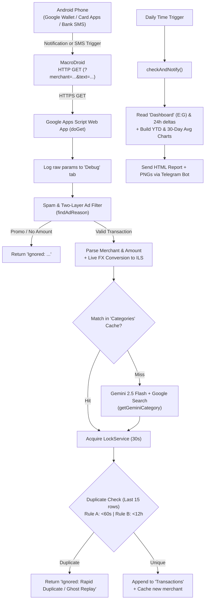

# ReceiptExtractor — Automated Wallet & Credit Card Expense Tracker

An end-to-end automated personal finance pipeline for **Android + Google Sheets + Google Apps Script + Gemini AI + Telegram**.

Whenever you pay with Google Wallet or receive a bank/credit card SMS or app notification (Isracard, Cal, MAX, Cibus/Pluxee, etc.), **MacroDroid** forwards the notification to a **Google Apps Script** Web App. The script filters out promotional spam, parses the merchant and amount, converts foreign currencies to ILS, categorizes the merchant using a local sheet cache or **Gemini 2.5 Flash with Google Search grounding**, deduplicates simultaneous/replayed notifications, logs the transaction to **Google Sheets**, and sends a daily **Telegram** budget report with cumulative and 30-day moving-average spending charts.

---

## Architecture



---

## Repository Structure

| File | Purpose |
| :--- | :--- |
| [`קוד.js`](קוד.js) | Apps Script entry points (`doGet`, `onOpen`, `checkAndNotify`), `LockService` deduplication, Gemini API call, currency conversion, and `Wallet Tools` repair utilities. *(Named in Hebrew to match the bound Apps Script project file.)* |
| [`parsing.js`](parsing.js) | Pure parsing and validation helpers (`findAdReason`, `parseMerchant`, `extractAmount`, `parseLocaleNumber`, `isMerchantMatch`, `normalizeCategory`, `CATEGORIES`). Contains zero Apps Script calls so it runs identically in Node and Apps Script. |
| [`appsscript.json`](appsscript.json) | Apps Script manifest (`Asia/Jerusalem` timezone, V8 runtime, Web App `USER_DEPLOYING` + `ANYONE_ANONYMOUS`). |
| [`tests.js`](tests.js) | Local Node.js test suite (59 tests) that loads `parsing.js` and `קוד.js` into a mocked Apps Script `vm` context. Excluded from `clasp push` via `.claspignore`. |
| [`.clasp.json.example`](.clasp.json.example) | Template for binding [`clasp`](https://github.com/google/clasp) to your own Apps Script project. Real `.clasp.json` is gitignored. |
| [`.claspignore`](.claspignore) | Ensures only `appsscript.json`, `parsing.js`, and `קוד.js` are pushed to Apps Script. |
| [`CONTEXT.md`](CONTEXT.md) | Architectural invariants and "do not touch" safeguards for contributors. |

---

## Prerequisites

1. **Google Account** with a Google Sheet for tracking expenses.
2. **Android Phone** with [**MacroDroid**](https://play.google.com/store/apps/details?id=com.arlosoft.macrodroid) installed.
3. **Google AI Studio API Key** ([aistudio.google.com](https://aistudio.google.com/)) for Gemini 2.5 Flash + Google Search grounding.
4. **Telegram Account** (to create a bot via `@BotFather` and receive daily reports).
5. *(Optional, for local development & CLI deploys)* **Node.js** and **`@google/clasp`**.

---

## Step 1: Set Up the Google Sheet ("Wallet Sheet")

Create a new Google Sheet (e.g., `Wallet`) and create the following **three tabs** with **exact** case-sensitive names:

### 1. `Transactions` tab
Row 1 headers (**Columns A–E**):

| Column | Header | Type / Notes |
| :---: | :--- | :--- |
| **A** | `Date` | Timestamp (written as a `Date` object by `doGet`). |
| **B** | `Merchant` | Cleaned merchant name extracted from the notification/SMS. |
| **C** | `Amount` | Numeric amount in **ILS** (`Number`). |
| **D** | `Category` | Expense category. Can use Google Sheets **Tables / Typed Column** dropdowns (see warning below). |
| **E** | `Raw Text` | Original notification/SMS body plus optional `[Orig: ...]` or `[UNCONVERTED: ...]` tags. |

> **Important — Google Sheets Typed Columns / Tables:**
> If you convert `Transactions` into a Google Sheets **Table** with a **Dropdown (Typed Column)** on Column D (`Category`), make sure the allowed dropdown options **exactly match** `CATEGORIES` in [`parsing.js`](parsing.js) (plus `Uncategorized`):
> `Groceries`, `Restaurants`, `Transport`, `Bills`, `Clothing`, `Health`, `Entertainment`, `Home Improvement`, `Beauty`, `Vacation`, `Uncategorized`.
> Never use Apps Script's legacy `DataValidationBuilder` on a Typed Column — Google Sheets will reject it.

### 2. `Categories` tab (Merchant Cache)
Row 1 headers (**Columns A–B**):

| Column | Header | Notes |
| :---: | :--- | :--- |
| **A** | `Merchant` | Cached merchant name (normalized at lookup time for quotes, dots, hyphens, branch suffixes, and 1–2 char terminal truncation). |
| **B** | `Category` | Target category name. |

- Whenever Gemini classifies a new merchant, `doGet` appends `[merchant, category]` here so future purchases at the same merchant skip the AI call.
- If a merchant is ever misclassified, **update both `Transactions` and `Categories`**, otherwise future transactions will keep using the cached category.

### 3. `Dashboard` tab (Used for Daily Telegram Reports)
`checkAndNotify()` specifically reads **Columns E, F, and G** starting at **Row 2** (`dashSheet.getRange(2, 5, lastRow - 1, 3)`):

| Column | Header (Row 1) | Example / Formula (Row 2+) |
| :---: | :--- | :--- |
| **A–D** | *(Free for your own KPIs)* | You can put monthly totals, charts, or notes in Columns A–D. |
| **E** | `Category` | `Groceries`, `Restaurants`, `Transport`, ... *(must match `Transactions` Column D)* |
| **F** | `Budget` | Monthly budget target in ILS (e.g., `2500`) |
| **G** | `Spent` | Current month's spend in ILS, e.g.:<br>`=SUMIFS(Transactions!$C:$C, Transactions!$D:$D, E2, Transactions!$A:$A, ">="&EOMONTH(TODAY(),-1)+1)` |

- Rows where both `Budget` and `Spent` are `0` (or `Category` is blank) are skipped in the Telegram report.
- Categories with `Budget > 0` and `Spent == 0` **are** shown (`🟢 Category: 0 / 1000`).
- If `Uncategorized` has `Spent > 0`, the Telegram message automatically prepends `⚠️ ACTION REQUIRED: Uncategorized Items!`.

### 4. `Debug` tab (Auto-created)
You do **not** need to create this manually. On the first incoming request, `doGet()` creates a `Debug` tab (`Date`, `Parameters`) and logs every raw webhook payload **before** any spam/amount/duplicate filters run.

---

## Step 2: Create the Telegram Bot & Find Chat IDs

1. **Create the Bot:**
   - Open Telegram and message **`@BotFather`**.
   - Send `/newbot`, choose a display name (e.g., `Wallet Tracker`) and a username ending in `bot` (e.g., `my_wallet_tracker_bot`).
   - Copy the **HTTP API Token** (looks like `1234567890:ABCdef...`). Keep this secret!
2. **Activate the Bot for Every Recipient:**
   - Every user who should receive daily reports (yourself, a partner, etc.) **must** open the new bot's link (`t.me/<your_bot_username>`) and press **Start** (`/start`). Telegram bots cannot initiate a chat with a user who hasn't started the bot.
3. **Get Each Recipient's Numeric `chat_id`:**
   - **Option A:** Send a message to your new bot, then open `https://api.telegram.org/bot<YOUR_BOT_TOKEN>/getUpdates` in a browser and read `result[0].message.chat.id`.
   - **Option B:** Message **`@userinfobot`** or **`@RawDataBot`** on Telegram and copy the numeric `Id`.
   - Combine multiple IDs as a comma-separated string, e.g., `111111111,222222222`.

---

## Step 3: Get a Gemini API Key

1. Go to [Google AI Studio](https://aistudio.google.com/) and sign in.
2. Click **Get API key → Create API key**.
3. Copy the key. Keep it secret!
4. The script uses **`gemini-2.5-flash`** with **Google Search grounding** (`"tools": [{ "google_search": {} }]`) so it actually looks up local/transliterated business names (e.g., `KOKPIT 67` → `קוקפיט 67`, a cocktail bar in Givatayim) instead of guessing literally. If search grounding returns a non-200 error (such as a tool quota error), `getGeminiCategory()` automatically retries without the `google_search` tool.

---

## Step 4: Deploy Google Apps Script & Configure Secrets

You can upload the script either via the browser editor or using `clasp`.

### Option A: Browser Editor (Copy & Paste)
1. Open your Google Sheet → **Extensions → Apps Script**.
2. Click **Project Settings (⚙️)** and check **"Show `appsscript.json` manifest file in editor"**.
3. Replace/create the files in the editor:
   - `appsscript.json` ← contents of [`appsscript.json`](appsscript.json)
   - `parsing.gs` ← contents of [`parsing.js`](parsing.js)
   - `Code.gs` ← contents of [`קוד.js`](קוד.js)

### Option B: CLI Deployment with `clasp` (Recommended)
1. Install `clasp` and log in:
   ```bash
   npm install -g @google/clasp
   clasp login
   ```
2. Open your Google Sheet → **Extensions → Apps Script** → **Project Settings (⚙️)** and copy the **Script ID**.
3. Copy the example config and paste your Script ID:
   ```bash
   cp .clasp.json.example .clasp.json
   ```
   Edit `.clasp.json` and replace `YOUR_GOOGLE_APPS_SCRIPT_ID` with your actual Script ID.
   > **Security:** `.clasp.json` is listed in `.gitignore` so your personal Script ID is never committed to Git.
4. Push the code:
   ```bash
   clasp push
   ```

### Configure Secrets in Script Properties (Required!)
**Never put tokens, API keys, or chat IDs in code.** Store them in Google Apps Script's encrypted-at-rest Script Properties:

1. In the Apps Script editor, click **Project Settings (⚙️)** on the left sidebar.
2. Scroll down to **Script Properties** and click **Add script property** for each of the three required keys:

| Property | Value | Example |
| :--- | :--- | :--- |
| `TELEGRAM_BOT_TOKEN` | Your bot token from `@BotFather` | `1234567890:AAH...` |
| `TELEGRAM_CHAT_IDS` | Comma-separated Telegram chat IDs | `111111111,222222222` |
| `GEMINI_API_KEY` | Your Google AI Studio API key | `AIzaSy...` |

3. Click **Save script properties**.

### Deploy as a Web App
1. In Apps Script, click **Deploy → New deployment**.
2. Click the gear icon next to "Select type" → **Web app**.
3. Configure:
   - **Description:** `MacroDroid Receipt Webhook v1`
   - **Execute as:** `Me` (`USER_DEPLOYING`)
   - **Who has access:** `Anyone` (`ANYONE_ANONYMOUS` — required because MacroDroid calls the endpoint without Google authentication cookies)
4. Click **Deploy**, authorize the requested Google permissions (Sheets + External URL requests), and **copy the Web App URL** (`https://script.google.com/macros/s/<DEPLOYMENT_ID>/exec`).

> **Crucial note on updates:** Whenever you change code later (including via `clasp push`), the live `/exec` URL remains pinned to the old deployment version until you go to **Deploy → Manage deployments → Edit (✏️) → Version: New version → Deploy**.

### Set Up the Daily Telegram Report Trigger
1. In Apps Script, open **Triggers (⏰)** on the left sidebar → **+ Add Trigger**.
2. Configure:
   - **Choose which function to run:** `checkAndNotify`
   - **Choose which deployment should run:** `Head`
   - **Select event source:** `Time-driven`
   - **Select type of time based trigger:** `Day timer`
   - **Select time of day:** e.g., `8pm to 9pm` (runs daily in `Asia/Jerusalem` timezone per `appsscript.json`)
3. Save and authorize if prompted. You can test it immediately by clicking **Run → `checkAndNotify`** in the Apps Script editor.

---

## Step 5: Configure MacroDroid on Android

To avoid missing transactions (some banks/cards don't populate amounts inside Google Wallet notifications, while contactless Wallet payments may appear before or separately from card SMSes), configure **two triggers** (or two separate macros) pointing to the same Web App URL. `LockService` + deduplication Rules A & B automatically prevent double entries.

### Macro 1: Bank / Credit Card SMS Trigger
1. **Triggers (Red):**
   - **SMS / Messaging → SMS Received**
   - **Select Contact:** `[Any Number]` *(cards often use alphabetical shortcodes like `Isracard`, `Cal`, `MAX`, or changing numbers)*
   - **Content:** `Contains` → **`בכרטיס`**
     > **Important:** Use **`בכרטיס`** (without the final `ך`), **NOT** `בכרטיסך`! Isracard writes `"בכרטיסך"` while Cal writes `"בכרטיס"`. Matching `"בכרטיס"` captures **both** issuers.
     > *(Alternatively, leave the SMS content filter blank or match multiple keywords like `עסקה` / `הסיבוס שלך` — the script's two-layer ad filter will safely ignore non-transaction SMSes.)*
2. **Actions (Blue):**
   - **Web Interactions → HTTP Request**
   - **Request Method:** `GET`
   - **URL:**
     ```text
     https://script.google.com/macros/s/YOUR_DEPLOYMENT_ID/exec?merchant={sms_number}&text={sms_message}
     ```
   - **Query Parameters / URL Encoding:** Make sure MacroDroid **URL-encodes** `{sms_number}` and `{sms_message}` (use MacroDroid's **Parameters** tab with `URL Encode` enabled, or wrap values if using raw URL mode) so Hebrew characters, `+`, `%`, `&`, and newlines don't break the query string.
   - **Timeout:** `45` seconds (allows time for `LockService` wait + Gemini Google Search lookup).
   - **Save Response** *(optional)*: Check for `Success` vs `Ignored: ...` during initial testing.

### Macro 2: App Notification Trigger (Google Wallet / Card Apps / Cibus)
1. **Triggers (Red):**
   - **Device Events → Notification → Notification Received**
   - **Select Application(s):** **Google Wallet**, **Isracard**, **Cal**, **MAX**, **Cibus / Pluxee** (whichever apps send purchase push alerts on your phone).
   - **Text Content:** `Any` *(do not worry about `"Preparing your receipt..."` — `doGet` filters it out)*.
2. **Actions (Blue):**
   - **Web Interactions → HTTP Request**
   - **Request Method:** `GET`
   - **URL:**
     ```text
     https://script.google.com/macros/s/YOUR_DEPLOYMENT_ID/exec?merchant={not_title}&text={notification}
     ```
   - Enable **URL Encode** on parameters and set timeout to `45` seconds.

### Recommended Android System Settings for Reliability
- **Battery Optimization:** Set MacroDroid to **Unrestricted** (Settings → Apps → MacroDroid → Battery → Unrestricted) so Android does not kill triggers in the background.
- **Permissions:** Grant MacroDroid **Notification Access**, **SMS**, and **Allow background data usage**.
- **Verify:** Make a small test purchase or send a test HTTP GET from MacroDroid, then check the **`Debug`** tab in your Google Sheet to confirm the payload arrived.

---

## Google Sheets Custom Menu (`Wallet Tools`)

When you open the spreadsheet, `onOpen()` adds a **`Wallet Tools`** menu with maintenance utilities:

| Menu Item | Function | What It Does |
| :--- | :--- | :--- |
| **Update All Categories** | `reprocessCategories()` | Scans the last 15 rows of `Transactions` where Category is empty or `Uncategorized`, checks `Categories` cache, and queries Gemini for up to 5 items per run (with a 4-second pause to respect free-tier rate limits). |
| **Sync & Deduplicate Categories** | `syncAndDeduplicateCategories()` | Deletes newer duplicate rows in `Categories` (keeping the oldest/canonical category) and backfills missing non-generic merchants from `Transactions`. |
| **Fix Misparsed Merchants** | `fixMisparsedMerchants()` | Re-runs `parseMerchant()` on Column E (`Raw Text`) across all `Transactions` rows and updates matching categories from cache. |
| **Fix Zero Amounts** | `fixZeroAmounts()` | Re-runs `extractAmount()` on rows where `Amount` is `0` or blank. |
| **Fix CZK Transactions (June 12-17)** | `fixCZKTransactions()` | Example one-time repair tool for a specific trip window where `CZK` transactions were saved without conversion. Skips rows already tagged `[Orig:]`. |
| **Remove SMS Ad Transactions** | `fixAdTransactions()` | Retroactively deletes rows from `Transactions` that match the live two-layer ad filter (`findAdReason`). |
| **Fix Unconverted Foreign Transactions** | `fixUnconvertedForeignTransactions()` | Finds unconverted USD/EUR/CZK/GBP rows (including `[UNCONVERTED: ...]` rows from failed live lookups) and converts them using **historical daily exchange rates** for each row's exact date via `frankfurter.app`. |

---

## Local Development & Testing

All pure parsing logic is shared between Google Apps Script and Node.js.

```bash
node tests.js
```

`tests.js` loads `parsing.js` and `קוד.js` into Node's `vm` with mocked Apps Script services (`SpreadsheetApp`, `LockService`, `PropertiesService`, `UrlFetchApp`, `Charts`, `ContentService`, `Utilities`) and executes **59 unit and regression tests** covering:
- Ad/promo filtering and safety words
- Israeli card SMS formats (Isracard, Cal, MAX, Cibus, Google Wallet)
- Locale number parsing, Unicode direction marks, and currency conversion
- Cache fuzzy matching & poisoning prevention
- Gemini JSON/grounding parsing and Script Properties validation
- `LockService` concurrency, Rapid Duplicate, Ghost Replay, and Telegram HTML escaping

You can also run `runUnitTests()` directly inside the Apps Script editor for a quick sanity check.

### Adding a New Currency
1. Add the currency token regex to `CURRENCY_PATTERNS` and its ISO code to `FOREIGN_CURRENCIES` in [`parsing.js`](parsing.js).
2. Add the same entry to `foreignCurrencies` in `fixUnconvertedForeignTransactions()` in [`קוד.js`](קוד.js).
3. Add a test case in [`tests.js`](tests.js) and run `node tests.js`.

---

## Security & Privacy Checklist

- **Secrets stay in Apps Script `Script Properties`:** `TELEGRAM_BOT_TOKEN`, `TELEGRAM_CHAT_IDS`, and `GEMINI_API_KEY` are never stored in source files.
- **`.clasp.json` is gitignored:** Only `.clasp.json.example` is tracked so your personal Apps Script `scriptId` stays private.
- **If a token was ever leaked in code or Git history:**
  - **Telegram:** Message `@BotFather` → `/revoke` → select your bot → paste the new token into Apps Script `Script Properties`.
  - **Gemini:** Delete/revoke the old key in [Google AI Studio](https://aistudio.google.com/) and generate a new one.

---

## Troubleshooting & FAQ (Lessons from Real Bugs)

<details>
<summary><strong>1. I switched my default card (e.g., Isracard → Cal) and transactions stopped appearing in the sheet!</strong></summary>

- **Step 1 — Check the `Debug` tab first:**
  - **Nothing in `Debug`:** MacroDroid never triggered or never sent the request.
  - **Row appears in `Debug`, missing in `Transactions`:** The script received it and rejected/misparsed it.
- **Root Cause & Fix:** Isracard SMS messages write `"בכרטיסך"`, whereas Cal writes `"בכרטיס"`.
  - In **MacroDroid**, change your SMS content filter from `"בכרטיסך"` to **`"בכרטיס"`** (substring match captures both!).
  - Make sure SMS transaction alerts are enabled with the new card issuer and that the new card's Android app is checked in your MacroDroid Notification trigger.
  - Ensure you have pushed the latest [`parsing.js`](parsing.js) (which checks `"בכרטיס"` in `parseMerchant`, `TX_KEYWORDS`, and `TX_SAFETY_WORDS`) and created a **new Web App deployment version**.

</details>

<details>
<summary><strong>2. Gemini categorized a local business literally and got it completely wrong (e.g., <code>KOKPIT 67</code> → <code>Transport</code> instead of <code>Restaurants</code>).</strong></summary>

- **Root Cause:** Without web search, LLMs guess from the literal English word (*"Cockpit"* → aviation → `Transport`) instead of recognizing transliterated Israeli businesses (`KOKPIT 67` = *קוקפיט 67*, a cocktail bar/pub in Givatayim). Worse, the wrong category gets saved to the `Categories` cache tab, so every future visit repeats the mistake!
- **How It Was Fixed:**
  - `getGeminiCategory()` now enables **Google Search grounding** (`tools: [{ google_search: {} }]`) and explicitly instructs the model to search both the original name and Hebrew transliteration and never guess from literal word meanings.
  - `normalizeCategory()` handles search citation markers (`Restaurants [1]`), singular forms (`Restaurant`), and multi-line responses.
- **What You Must Do When Fixing a Misclassification:** Fix the category in **both** the `Transactions` tab **and** the `Categories` cache tab (or delete the row in `Categories`).

</details>

<details>
<summary><strong>3. Duplicate transactions appear when MacroDroid fires from both Google Wallet and SMS, or old notifications replay hours later.</strong></summary>

- **Root Cause:**
  1. MacroDroid fires multiple webhooks within milliseconds of a purchase (concurrency race condition).
  2. Android Notification Grouping occasionally replays old notifications hours later ("Ghost Replay").
- **How It Was Fixed:**
  - `doGet` acquires `LockService.getScriptLock().waitLock(30000)` before checking duplicates and writing. (Gemini AI calls happen *before* the lock so slow API calls don't cause lock timeouts.)
  - **Rule A (Rapid Duplicate):** Drops any transaction with the same amount (`< 0.01` diff) arriving within **60 seconds**.
  - **Rule B (Ghost Replay):** Drops any transaction with the same amount and **identical `Raw Text`** arriving within **12 hours** (`43200` seconds).

</details>

<details>
<summary><strong>4. Amounts are saved as <code>0</code>, rejected as <code>No Amount</code>, or extract the card's last 4 digits (e.g., <code>1234</code>).</strong></summary>

- **Root Cause:** Israeli bank SMS messages inject invisible Unicode bidirectional control marks (`\u200F` RLM, `\u202A` LRE, etc.) around numbers and currency symbols, breaking standard regexes. Naive fallback regexes also match card digits (`בכרטיס 1234`).
- **How It Was Fixed:**
  - `extractAmount()` strips `[\u200B-\u200F\u202A-\u202E\u061C]` before matching.
  - Two-level extraction requires either an explicit amount keyword (`בסך`, `על סך`, `חוייב ב`, `Amount`, `Sum`, `Total`) or a currency symbol/code (`₪`, `USD`, etc.) — **never** falling back to bare numbers.
  - Run **Wallet Tools → Fix Zero Amounts** (`fixZeroAmounts`) to repair historical rows.

</details>

<details>
<summary><strong>5. Promotional / spam SMS messages are logged as transactions, OR legitimate merchants like <code>Costco Wholesale</code> get blocked as ads.</strong></summary>

- **Root Cause:**
  - Promo SMSes contain numbers and shekel signs (e.g., `"ב-₪599 בלבד במקום ₪1,490"`, `"YUMMI 28.2.26"`).
  - Naive substring matching on `"sale"` falsely blocked `"Wholesale"`.
- **How It Was Fixed:**
  - **Layer 1 (`findAdReason`):** Hebrew promo keywords (`הנחה`, `מבצע`, `במקום`, `בלבד`, `להסרה`, `מועדון`, etc.) + **word-boundary** English regex (`\b(?:sales?|promo\w*|discounts?)\b` — so `"Wholesale"` is safe), bypassed only if a real transaction safety word (`חוייב`, `אושרה`, `עסקה`, `בכרטיס`, `paid`, etc.) is present.
  - **Layer 2:** SMS messages with zero transaction keywords (`TX_KEYWORDS`) are rejected as `Ignored: SMS Ad`.
  - Run **Wallet Tools → Remove SMS Ad Transactions** (`fixAdTransactions`) to clean up past spam rows.

</details>

<details>
<summary><strong>6. Merchant name gets saved as a date (<code>"תאריך 01/10"</code>) or cut off at acronym dots (<code>"אי"</code> instead of <code>"אי.אם.פי.אם כצנלסון"</code>, <code>"קיי"</code> instead of <code>"קיי.אס.פי מחשבים רמת"</code>).</strong></summary>

- **Root Cause:** Earlier regex patterns overwrote each other, matched dates in `"עסקה ב-14/10 בסך ..."`, or stopped at the first period `.` inside Hebrew acronyms.
- **How It Was Fixed:**
  - `parseMerchant()` uses **first-match-wins** ordered patterns, a negative lookahead `(?!\s*\d{1,2}[./]\d{1,2})` to skip dates, and looks for sentence-ending dots (`\.\s*(?:\r?\n|$|למידע|לשירותך)`) instead of any internal dot.
  - Run **Wallet Tools → Fix Misparsed Merchants** (`fixMisparsedMerchants`) to retroactively repair `Transactions`.

</details>

<details>
<summary><strong>7. Foreign currency amounts are mis-parsed (<code>250,00 Kč</code> → <code>25000</code>), stored as <code>NaN</code>, or unconverted when traveling.</strong></summary>

- **Root Cause:**
  - European format uses `.` for thousands and `,` for decimals (`1.234,56 EUR`, `250,00 Kč`).
  - Live exchange rate API outages or missing currency codes caused `NaN` or mislabeled `[Orig:]` tags.
- **How It Was Fixed:**
  - `parseLocaleNumber()` intelligently handles both US/IL (`1,234.56`) and EU (`1.234,56`, `250,00`) conventions.
  - `convertToILS()` verifies `rate > 0`. If live conversion fails, `doGet()` preserves the foreign amount and tags the raw text with `[UNCONVERTED: ...]` instead of `[Orig:]`.
  - Run **Wallet Tools → Fix Unconverted Foreign Transactions** (`fixUnconvertedForeignTransactions`) to convert them using historical rates for each transaction's exact date via `frankfurter.app`.

</details>

<details>
<summary><strong>8. <code>"SMS"</code> or a phone number poisoned the <code>Categories</code> cache, or Gemini returned <code>"Food"</code> / JSON instead of an allowed category.</strong></summary>

- **Root Cause:** If `parseMerchant()` fell back to `"SMS"` and that got cached, every future unparsed SMS matched `"SMS"` in `Categories`. Off-list AI strings (`"Food"`, `{"category": "groceries"}`) also broke Dashboard `SUMIFS`.
- **How It Was Fixed:**
  - `isGenericMerchant()` prevents `"SMS"`, 1-char strings, and phone numbers from ever being sent to Gemini or cached.
  - `normalizeCategory()` enforces the strict `CATEGORIES` allowlist (defaulting anything unknown to `"Uncategorized"`).
  - Run **Wallet Tools → Sync & Deduplicate Categories** (`syncAndDeduplicateCategories`) to clean duplicates and sync missing merchants.

</details>

<details>
<summary><strong>9. <code>checkAndNotify</code> hits Google's 6-minute execution timeout, crashes on empty Dashboard, or fails to send Telegram messages with <code>&amp;</code> in category names.</strong></summary>

- **Root Cause:** Calling `Utilities.formatDate()` inside a nested loop over 365 days triggers thousands of Apps Script service calls; Telegram `parse_mode: 'HTML'` rejects unescaped `&` (e.g., `Food & Drinks`).
- **How It Was Fixed:**
  - Chart data uses an `O(N)` sliding window with lightweight `dateToKey()` string formatting.
  - `escapeHtml()` escapes `&`, `<`, `>` on category names.
  - Empty `Dashboard` sheets are handled gracefully without throwing range errors.

</details>

<details>
<summary><strong>10. I pushed new code with <code>clasp push</code>, why is MacroDroid still running the old behavior?</strong></summary>

- **Root Cause:** `clasp push` updates the `HEAD` script code, **not** an existing versioned Web App deployment (`/exec`).
- **Fix:** In Apps Script, open **Deploy → Manage deployments → ✏️ Edit → Version: New version → Deploy**. (No need to change the URL in MacroDroid as long as you edit the existing deployment rather than creating a new one.)

</details>

<details>
<summary><strong>11. <code>clasp push</code> failed or threw an error about Google Sheets Data Validation on the Category column.</strong></summary>

- **Root Cause:** Using `DataValidationBuilder` against a Google Sheets **Typed Column / Table** throws an error because Typed Columns enforce schema validation natively.
- **Fix:** Keep Column D's dropdown options configured in the Google Sheets UI and keep `CATEGORIES` in [`parsing.js`](parsing.js) in sync manually.

</details>
